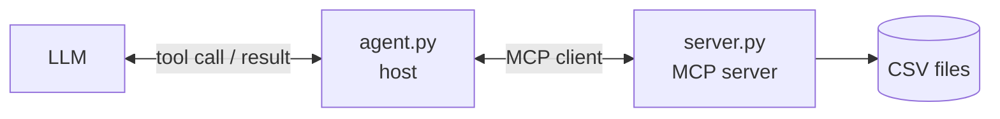

# MCP Connect Demo

The smallest complete example of **connecting an LLM to an MCP server**. It has three small files:

| File | What it is | Needs an API key? |
|---|---|---|
| [`server.py`](src/mcp_demo/server.py) | An **MCP server** that exposes three read-only tools over CSV files | No |
| [`client.py`](src/mcp_demo/client.py) | A **plain MCP client**: connect, list tools, call one. No LLM | No |
| [`agent.py`](src/mcp_demo/agent.py) | Connects an **LLM** to the server's tools, so the model decides which to call | Yes |

New to MCP? The companion guide explains the ideas with diagrams and the real messages:
**MCP explained** (website). This repo is the working code behind it.

## How it fits together



The model never talks to the server. The agent translates: it hands the server's tools to the model, and when the
model asks for a tool, the agent sends the matching `tools/call` message and returns the result.

## The three tools

| Tool | Input | Returns |
|---|---|---|
| `get_files_list` | none | the CSV files the server can read |
| `get_schema` | `file_location` | column names and types |
| `execute_polars_sql` | `file_locations`, `query` | the rows of a Polars SQL query (table name `self`) |

## Setup

You need **Python 3.11+** and **git**.

```bash
git clone https://github.com/arunak1998/mcp-connect-demo.git
cd mcp-connect-demo

python -m venv .venv
source .venv/bin/activate        # Windows (PowerShell): .venv\Scripts\Activate.ps1
pip install -e .                 # server + plain client
```

### 1. Start the server

```bash
mcp-demo-server
```

It serves MCP at `http://127.0.0.1:8050/mcp` and reads `data/*.csv` (a sample sales file is included). Leave it
running.

### 2. Connect with the plain client (no key)

In a second terminal (activate the environment again):

```bash
python -m mcp_demo.client
```

It performs the handshake, prints the tools the server offers, and runs a SQL query through MCP.

### 3. Connect an LLM (needs a key)

```bash
pip install -e ".[llm]"          # LangChain + the MCP adapter + an OpenAI-compatible model package
cp .env.example .env             # Windows (PowerShell): copy .env.example .env
```

Open `.env` and replace `your_api_key_here` with your key:

```
LLM_API_KEY=sk-...
```

| Setting | Required | Purpose |
|---|---|---|
| `LLM_API_KEY` | **Yes** | Your API key. |
| `LLM_BASE_URL` | No | Only for a gateway or proxy. Leave it out to use OpenAI directly. |
| `LLM_MODEL` | No | Model name. Default `gpt-5-mini`. |
| `LLM_REASONING_EFFORT` | No | `minimal` speeds up gpt-5 models. Delete the line for other models. |

Then ask a question:

```bash
python -m mcp_demo.agent "Which region has the highest total revenue?"
```

You will see each tool the model asks for and what MCP returns, then the answer. To use a different provider
(Anthropic, Gemini, ...), install its LangChain package and swap `create_llm()` in `agent.py`.

### 4. Connect any other MCP client

The server speaks the standard protocol, so any client can use it. With the official inspector:

```bash
npx @modelcontextprotocol/inspector
```

Choose the **Streamable HTTP** transport and enter `http://127.0.0.1:8050/mcp`.

## Configuration

| Variable | Default | Purpose |
|---|---|---|
| `FILE_LOCATION` | `data/*.csv` | Glob of CSV files the server can read |
| `MCP_HOST` / `MCP_PORT` | `127.0.0.1` / `8050` | Where the server listens |
| `MCP_SERVER_URL` | `http://127.0.0.1:8050/mcp` | Where the client and agent connect |

## Safety

- The server listens on `127.0.0.1` only. Its SQL tool reads any file path it is given, so do not expose it
  publicly without authentication.
- A failing tool returns `isError: true`. `client.py` turns that into an exception so an error message is never
  mistaken for data.

## Development

```bash
pip install -e ".[llm,dev]"
pytest                          # no network and no API key needed
ruff check . && ruff format --check .
```
